<div align="center">



<br/>

<a href="https://git.io/typing-svg">
  
</a>

<br/>


</div>

<br/>


## 👨‍💻 About Me

<table>
<tr>
<td width="50%" valign="top">

### 🧑‍💻 Info

```yaml
name: Nour Hassan Pindhe (Eng.)
handle: "@pindhe"
location: Hargeisa, Somaliland 🇸🇴
role:
  - Full-Stack Developer
  - UI/UX Designer
  - AI Engineer
focus: Web • Mobile • AI-powered products
learning: Advanced AI Systems & Cloud
reach_me: kharash420@gmail.com
```

<div align="center">
  
</div>

</td>
<td width="50%" valign="middle" align="center">

### 🗺️ Somaliland


<sub>📍 Based in <b>Hargeisa</b> — building for the Horn of Africa</sub>

</td>
</tr>
</table>

<br/>


## 🌐 Connect With Me

<div align="center">

<table>
<tr>
<td align="center" width="140">
  <a href="https://engpindhe.vercel.app/" target="_blank">
    
  </a>
</td>
<td>🚀 &nbsp;My work, projects & case studies</td>
</tr>
<tr>
<td align="center">
  <a href="https://www.linkedin.com/in/nour-hassan-nour/" target="_blank">
    
  </a>
</td>
<td>💼 &nbsp;Professional network & opportunities</td>
</tr>
<tr>
<td align="center">
  <a href="https://github.com/pindhe" target="_blank">
    
  </a>
</td>
<td>💻 &nbsp;Open-source code & repositories</td>
</tr>
<tr>
<td align="center">
  <a href="https://www.youtube.com/@pindhe" target="_blank">
    
  </a>
</td>
<td>🎬 &nbsp;Tutorials & build videos</td>
</tr>
<tr>
<td align="center">
  <a href="https://www.instagram.com/pindhe_1/" target="_blank">
    
  </a>
</td>
<td>📸 &nbsp;Daily life & behind the scenes</td>
</tr>
<tr>
<td align="center">
  <a href="https://www.facebook.com/pindhe2k" target="_blank">
    
  </a>
</td>
<td>👥 &nbsp;Community & updates</td>
</tr>
<tr>
<td align="center">
  <a href="mailto:kharash420@gmail.com">
    
  </a>
</td>
<td>✉️ &nbsp;kharash420@gmail.com</td>
</tr>
</table>

</div>

<br/>


## 🛠️ Tech Stack & Tools

<div align="center">

<table>
<tr>
<th width="190" align="center">Category</th>
<th align="center">Stack</th>
</tr>

<tr>
<td align="center"><b>🎨 Frontend</b></td>
<td align="center">

<br/>
<sub>HTML · CSS · JavaScript · TypeScript · React · Next.js · Vue · Tailwind · Bootstrap · Vite</sub>
</td>
</tr>

<tr>
<td align="center"><b>⚙️ Backend</b></td>
<td align="center">

<br/>
<sub>Node.js · Express · Python · Django · Flask · FastAPI · PHP · Laravel · Java · C#</sub>
</td>
</tr>

<tr>
<td align="center"><b>🗄️ Database</b></td>
<td align="center">

<br/>
<sub>MySQL · PostgreSQL · MongoDB · SQLite · Redis · Firebase · Supabase</sub>
</td>
</tr>

<tr>
<td align="center"><b>🤖 AI & ML</b></td>
<td align="center">

<br/>


<br/>
<sub>LLM Integration · Prompt Engineering · RAG · AI Agents · Computer Vision</sub>
</td>
</tr>

<tr>
<td align="center"><b>📱 Mobile</b></td>
<td align="center">

<br/>
<sub>Flutter · Dart · Kotlin · Swift · Android Studio</sub>
</td>
</tr>

<tr>
<td align="center"><b>☁️ Cloud & DevOps</b></td>
<td align="center">

<br/>
<sub>GCP · AWS · Docker · Nginx · Linux · GitHub Actions · Vercel · Netlify</sub>
</td>
</tr>

<tr>
<td align="center"><b>🖌️ Design</b></td>
<td align="center">

<br/>
<sub>Figma · Photoshop · Illustrator · Blender · Adobe XD</sub>
</td>
</tr>

<tr>
<td align="center"><b>🧰 Tools</b></td>
<td align="center">

<br/>
<sub>Git · GitHub · VS Code · Postman · npm · IntelliJ · Bash · Notion</sub>
</td>
</tr>
</table>

</div>

<br/>


## 📊 GitHub Analytics

<div align="center">


<br/>


<br/>


<br/><br/>


<br/><br/>


<br/><br/>


</div>

<br/>


## 🧊 3D Contribution Calendar

<div align="center">
  

  <br/><br/>

  
</div>

> ℹ️ Two GitHub Actions power this section — see setup notes at the bottom: the **snake** animation (eats your contribution graph) and **profile-3d-contrib** (renders an isometric 3D bar chart of your daily commits, rotating and re-rendered daily).

<br/>


<div align="center">

### 💡 "Code with purpose. Design with soul. Ship with pride."


</div>

<!--
═══════════════════════════════════════════════
SETUP NOTES — GitHub Actions required
═══════════════════════════════════════════════

0) MAP
   Upload somaliland-map.svg to the root of your profile repo (next to README.md and banner.svg).

1) CONTRIBUTION SNAKE (animates the grid into a snake eating your squares)
   Repo: Platane/snk
   Workflow file: .github/workflows/snake.yml

   name: generate snake
   on:
     schedule:
       - cron: "0 */6 * * *"
     workflow_dispatch: {}
     push:
       branches: [ main ]
   jobs:
     generate:
       permissions:
         contents: write
       runs-on: ubuntu-latest
       steps:
         - uses: Platane/snk@v3
           with:
             github_user_name: pindhe
             outputs: |
               dist/github-contribution-grid-snake-dark.svg?palette=github-dark
               dist/github-contribution-grid-snake.svg
         - uses: crazy-max/ghaction-github-pages@v4
           with:
             target_branch: output
             build_dir: dist
           env:
             GITHUB_TOKEN: ${{ secrets.GITHUB_TOKEN }}

2) 3D CONTRIBUTION GRAPH (isometric bar chart, rotates daily)
   Repo: yoshi389111/github-profile-3d-contrib
   Create a repo named exactly: profile-3d-contrib
   Workflow file: .github/workflows/profile-3d-contrib.yml

   name: 3D Profile
   on:
     schedule:
       - cron: "0 0 * * *"
     workflow_dispatch: {}
   jobs:
     build:
       runs-on: ubuntu-latest
       steps:
         - uses: actions/checkout@v4
         - uses: yoshi389111/github-profile-3d-contrib@0.7.1
           env:
             GITHUB_TOKEN: ${{ secrets.GITHUB_TOKEN }}
             USERNAME: pindhe
         - uses: stefanzweifel/git-auto-commit-action@v5
           with:
             commit_message: "generate 3D profile"

   After the first run, the SVGs land at:
     profile-night-rainbow.svg / profile-night-view.svg / profile-day-view.svg
   Swap the color scheme in the README image URL above if you prefer a different variant.

3) BANNER
   ./banner.svg is your existing custom banner — untouched here since it's already animated.
═══════════════════════════════════════════════
-->
